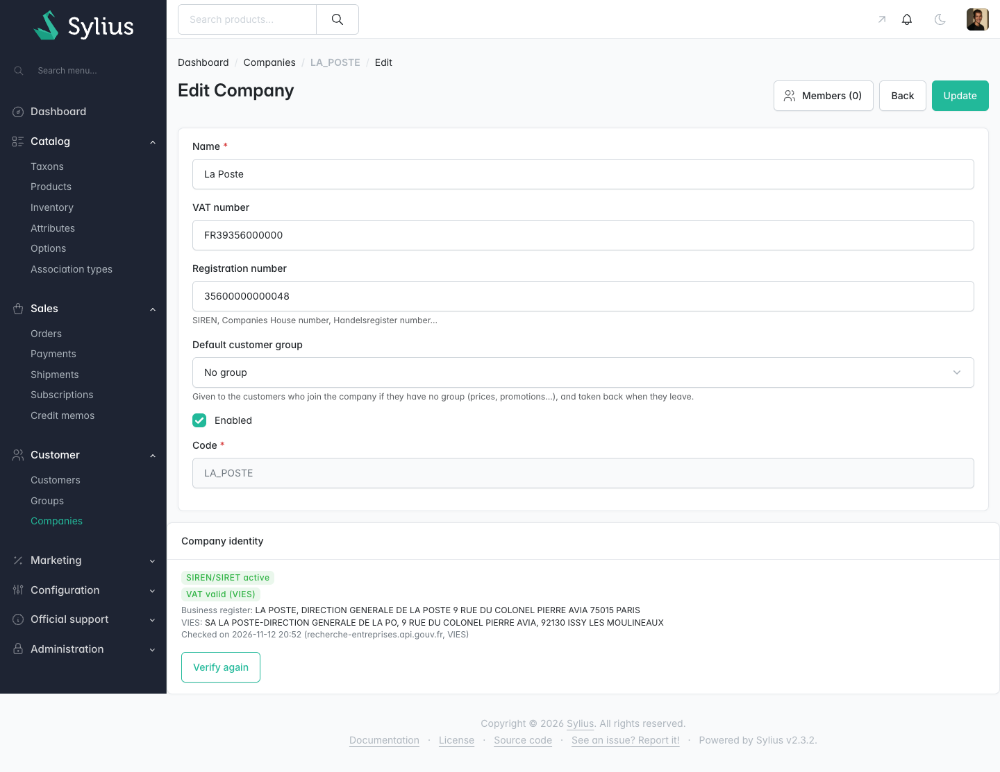

# Sylius Company Verification Plugin

> English: [README.md](README.md) <!-- vitrine:lang -->

[](https://github.com/thibmonier/sylius-company-verification-plugin/actions/workflows/build.yaml)
[](LICENSE)

**Montrez à l'administrateur, avant l'approbation d'un compte B2B, si le SIREN/SIRET existe au registre français des entreprises et si le numéro de TVA intracommunautaire est valide dans VIES.**

Construit sur [`tmonier/sylius-company-accounts-plugin`](https://github.com/thibmonier/sylius-company-accounts-plugin) : le plugin lit le `registrationNumber` (SIREN ou SIRET) et le `vatNumber` de sa `Company` et enregistre ce que répondent deux services publics. Il se contente d'informer : **aucune décision n'est prise automatiquement**, rien n'est approuvé, refusé ou bloqué selon le résultat.

## Fonctionnalités

- **Contrôle de format à l'enregistrement de l'entreprise.** Une contrainte sur `Company` (groupe de validation `sylius`) refuse un SIREN ou un SIRET dont la clé de Luhn est fausse, et un numéro de TVA qui n'est pas un code pays suivi du numéro (un numéro français voit aussi sa clé vérifiée). Le contrôle est local : aucune requête ne sort du serveur. Le numéro d'immatriculation d'une entreprise dont le numéro de TVA ne commence pas par `FR` n'est pas traité comme un SIREN/SIRET et n'est pas contrôlé.
- **Recherche au registre des entreprises.** Un SIREN ou un SIRET valide est recherché dans l'[API Recherche d'entreprises](https://recherche-entreprises.api.gouv.fr) (`GET https://recherche-entreprises.api.gouv.fr/search`). Résultat : actif, fermé (avec la date de fermeture si elle est connue), introuvable, sans objet, non vérifié. Le nom et l'adresse renvoyés sont affichés à côté de l'identifiant saisi.
- **Contrôle du numéro de TVA.** Un numéro de TVA bien formé est vérifié dans VIES par l'API REST de la Commission européenne (`POST https://ec.europa.eu/taxation_customs/vies/rest-api/check-vat-number`, voir le [site VIES](https://ec.europa.eu/taxation_customs/vies/)). Résultat : valide, invalide, pas de numéro de TVA, non vérifié, avec le nom et l'adresse que VIES renvoie lorsque l'État membre les fournit.
- **Demande automatique, asynchrone si vous l'acheminez.** Une vérification est demandée (message `VerifyCompany`, envoyé sur `sylius.command_bus`) à la création d'une entreprise et lorsque son `vatNumber` ou son `registrationNumber` change, une fois l'entreprise enregistrée. La modification d'un autre champ ne demande rien. Le message est traité de façon synchrone tant que vous ne l'acheminez pas vers un transport Messenger.
- **Historique.** Chaque exécution est conservée (table `tmonier_company_verification`, une ligne par exécution, avec les identifiants tels qu'ils ont été vérifiés, les sources et la date). La dernière ligne est l'état courant ; les lignes sont supprimées avec l'entreprise.
- **Badge et bouton dans l'administration.** La page d'édition de l'entreprise affiche un panneau avec les statuts en toutes lettres (pas par la seule couleur), le nom et l'adresse renvoyés, les sources et la date, et un bouton **Vérifier à nouveau** (formulaire POST, jeton CSRF, rôle `ROLE_ADMINISTRATION_ACCESS`).
- **Commande console.** `bin/console tmonier:company-verification:verify-unverified` demande une vérification pour les entreprises jamais vérifiées et pour celles dont la dernière exécution n'a pas pu joindre un service. Planifiez-la (cron) si vous voulez ces reprises : il n'y a aucune reprise automatique cachée.
- **Traductions.** Anglais et français.

### Quand un service est indisponible

Un délai dépassé, une erreur de connexion, une réponse autre que 200, une réponse que le plugin ne comprend pas ou une réponse d'erreur de VIES (elle ne contient pas d'indicateur `valid`) donnent le statut **non vérifié (service indisponible)**. Il n'est jamais lu comme « invalide » ou « introuvable », et l'exécution est tout de même enregistrée. Aucune redirection n'est suivie. Quand le service est revenu, utilisez le bouton **Vérifier à nouveau** ou la commande console ci-dessus.

### Données envoyées aux services

Uniquement des identifiants publics d'entreprise, déjà contrôlés au format : le SIREN/SIRET au registre (paramètre `q`), le code pays et le numéro de TVA à VIES. Aucun nom, adresse, e-mail ni donnée de client n'est envoyé, et les réponses brutes ne sont jamais conservées (seuls le statut, le nom, l'adresse et la date de fermeture le sont). Les deux hôtes viennent de la configuration, jamais d'une saisie utilisateur.

## Captures d'écran



*Page d'édition de l'entreprise : badge de vérification, nom et adresse renvoyés, sources et date, bouton « Vérifier à nouveau »*

## Prérequis

| | Versions prises en charge |
|---|---|
| PHP | 8.2 à 8.4 |
| Sylius | 2.2.9+ et 2.3 |
| Symfony | 6.4, 7.4 |
| `tmonier/sylius-company-accounts-plugin` | ^1.3 |
| Base de données | MySQL 8.4 (celle de la CI) |
| Messenger | `symfony/messenger` (bus de commandes de Sylius) |

Le badge de *Clients > Inscriptions* de [`tmonier/sylius-registration-approval-plugin`](https://github.com/thibmonier/sylius-registration-approval-plugin) exige Sylius 2.3. La colonne est ajoutée à sa grille lorsque ce plugin est installé ; c'est la seule partie qui n'est pas couverte par un test exécuté ici (un test vérifie que la colonne est déclarée, et il est ignoré quand le plugin d'approbation n'est pas installé).

Le plugin est en version 0.x : sa configuration peut évoluer entre versions mineures, lisez le [CHANGELOG](CHANGELOG.md) avant de mettre à jour.

## Installation

1. Installez et configurez d'abord `tmonier/sylius-company-accounts-plugin` (voir son README), puis :

    ```bash
    composer require tmonier/sylius-company-verification-plugin
    ```

2. Enregistrez le bundle dans `config/bundles.php` (après le plugin de comptes entreprise) :

    ```php
    Tmonier\SyliusCompanyVerificationPlugin\TmonierSyliusCompanyVerificationPlugin::class => ['all' => true],
    ```

3. Importez la configuration (hook Twig de la page entreprise) dans `config/packages/_sylius.yaml` :

    ```yaml
    imports:
        - { resource: "@TmonierSyliusCompanyVerificationPlugin/config/config.yaml" }
    ```

4. Importez la route (le bouton *Vérifier à nouveau*) dans `config/routes.yaml` :

    ```yaml
    tmonier_sylius_company_verification:
        resource: "@TmonierSyliusCompanyVerificationPlugin/config/routes.yaml"
    ```

5. Lancez la migration (une nouvelle table, le plugin enregistre lui-même ses migrations) :

    ```bash
    bin/console doctrine:migrations:migrate
    ```

La route est `tmonier_company_verification_admin_verify` (`POST /<chemin de l'administration>/companies/{id}/verification`).

## Configuration

Toutes les clés sont facultatives (`config/packages/tmonier_sylius_company_verification.yaml`) :

```yaml
tmonier_sylius_company_verification:
    register_url: 'https://recherche-entreprises.api.gouv.fr/search'
    vies_url: 'https://ec.europa.eu/taxation_customs/vies/rest-api/check-vat-number'
    timeout: 15.0   # secondes, requête et durée totale ; entre 0,5 et 30
```

Le délai par défaut est de 15 secondes, car VIES met 7 à 8 secondes à répondre pour la France et répond parfois `MS_MAX_CONCURRENT_REQ` (constaté sur l'API réelle le 2026-11-12) ; cette réponse donne « non vérifié », comme toute autre erreur du service.

Pour traiter les vérifications hors de la requête web, acheminez le message vers un transport :

```yaml
framework:
    messenger:
        routing:
            Tmonier\SyliusCompanyVerificationPlugin\Message\VerifyCompany: async
```

## Plugins complémentaires

Ce plugin vérifie qu'une entreprise existe et que son numéro de TVA est valide. Il ne calcule aucune taxe. Les plugins communautaires [`gewebe/sylius-vat-plugin`](https://packagist.org/packages/gewebe/sylius-vat-plugin) et [`flux-se/sylius-eu-vat-plugin`](https://packagist.org/packages/flux-se/sylius-eu-vat-plugin) traitent la TVA appliquée à une commande à partir de l'adresse ; ils répondent à une autre question et peuvent être utilisés en complément.

## Limites

- Les entreprises hors de France ne sont contrôlées que par VIES (et seulement pour les pays que VIES couvre) ; leur numéro d'immatriculation n'est pas recherché.
- Un numéro de TVA non français n'est contrôlé au format que comme un code pays suivi de 2 à 13 caractères ; VIES dit ensuite s'il existe.
- Un nom ou une adresse différents de ceux saisis sont affichés, pas comparés : l'administrateur lit et décide.
- Les services publics ont leur propre disponibilité et leurs propres limites de débit ; le plugin ne met pas les requêtes en file ni ne les limite.
- Le résultat indique qu'un identifiant est connu d'un service au moment du contrôle. Ce n'est pas une preuve de l'identité de la personne qui s'est inscrite, ni un conseil juridique ou de conformité.

## Développement

```bash
composer install
docker compose up -d --wait
vendor/bin/phpunit
vendor/bin/ecs check
vendor/bin/phpstan analyse
```

Les tests n'appellent jamais les vrais services : les clients HTTP sont remplacés par des réponses simulées (actif, fermé, introuvable, entreprise étrangère, indisponible).

## Auteur

[Thibaut Monier](https://www.linkedin.com/in/thibautmonier/) – Delivery Manager IA / Tech Lead

## Licence

MIT, voir [LICENSE](LICENSE).
