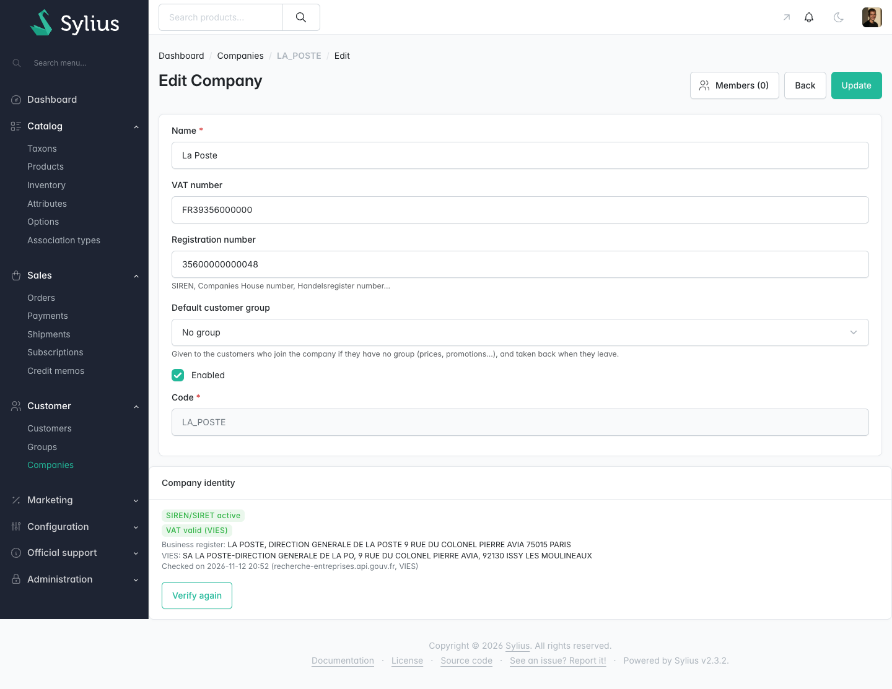

# Sylius Company Verification Plugin

> Français : [README.fr.md](README.fr.md) <!-- vitrine:lang -->

[](https://github.com/thibmonier/sylius-company-verification-plugin/actions/workflows/build.yaml)
[](LICENSE)

**Show the administrator, before a B2B account is approved, whether its SIREN/SIRET exists in the French business register and whether its EU VAT number is valid in VIES.**

Built on [`tmonier/sylius-company-accounts-plugin`](https://github.com/thibmonier/sylius-company-accounts-plugin): the plugin reads the `registrationNumber` (SIREN or SIRET) and the `vatNumber` of its `Company` and records what two public services answer. It only informs: **no decision is taken automatically**, nothing is approved, refused or blocked on the result.

## Features

- **Format check when the company is saved.** A constraint on `Company` (validation group `sylius`) refuses a SIREN or SIRET with a wrong Luhn key, and a VAT number that is not a country code followed by the number (a French number also gets its key checked). The check is local: no request leaves the server. The registration number of a company whose VAT number does not start with `FR` is not treated as a SIREN/SIRET and is not checked.
- **Business register lookup.** A valid SIREN or SIRET is looked up in the [API Recherche d'entreprises](https://recherche-entreprises.api.gouv.fr) (`GET https://recherche-entreprises.api.gouv.fr/search`). The result is one of: active, closed (with the closing date when given), not found, not applicable, not verified. The name and the address returned are shown next to the identifier you typed.
- **VAT number check.** A well-formed VAT number is checked in VIES through the REST API of the European Commission (`POST https://ec.europa.eu/taxation_customs/vies/rest-api/check-vat-number`, see the [VIES site](https://ec.europa.eu/taxation_customs/vies/)). The result is valid, invalid, no VAT number, or not verified, with the name and address VIES returns when the member state gives them.
- **Automatic request, asynchronous when you route it.** A verification is requested (`VerifyCompany` message, dispatched on `sylius.command_bus`) when a company is created and when its `vatNumber` or `registrationNumber` changes, once the company is saved. Changing any other field asks for nothing. The message is handled synchronously until you route it to a Messenger transport.
- **History.** Every run is kept (table `tmonier_company_verification`, one line per run, with the identifiers as they were checked, the sources and the date). The latest line is the current state; the lines are deleted with the company.
- **Badge and button in the administration.** The company edit page shows a panel with the statuses in words (not by colour alone), the name and address returned, the sources and the date, and a **Verify again** button (POST form, CSRF token, role `ROLE_ADMINISTRATION_ACCESS`).
- **Console command.** `bin/console tmonier:company-verification:verify-unverified` requests a verification for the companies never verified and for those whose latest run could not reach a service. Schedule it (cron) if you want those retried: there is no hidden automatic retry.
- **Translations.** English and French.

### When a service is unavailable

A timeout, a connection error, a non-200 answer, an answer the plugin does not understand, or a VIES error answer (it carries no `valid` flag) gives the status **not verified (service unavailable)**. It is never read as "invalid" or "not found", and the run is still recorded. No redirect is followed. Once the service is back, use the **Verify again** button or the console command above.

### Data sent to the services

Only public company identifiers, already format-checked: the SIREN/SIRET to the register (`q` parameter), the country code and the VAT number to VIES. No name, address, e-mail or customer data is sent, and the raw responses are never stored (only the status, the name, the address and the closing date). The two hosts come from the configuration, never from user input.

## Screenshots



*Company edit page: verification badge, name and address returned, sources and date, "Verify again" button*

## Requirements

| | Supported |
|---|---|
| PHP | 8.2 to 8.4 |
| Sylius | 2.2.9+ and 2.3 |
| Symfony | 6.4, 7.4 |
| `tmonier/sylius-company-accounts-plugin` | ^1.3 |
| Database | MySQL 8.4 (the one the CI runs) |
| Messenger | `symfony/messenger` (Sylius command bus) |

The badge in *Customers > Registrations* of [`tmonier/sylius-registration-approval-plugin`](https://github.com/thibmonier/sylius-registration-approval-plugin) needs Sylius 2.3. The column is added to its grid when that plugin is installed; this is the only part not covered by a running test here (one test checks that the column is declared, and is skipped when the approval plugin is not installed).

The plugin is at version 0.x: its configuration may change between minor versions, read the [CHANGELOG](CHANGELOG.md) before upgrading.

## Installation

1. Install and configure `tmonier/sylius-company-accounts-plugin` first (its README), then:

    ```bash
    composer require tmonier/sylius-company-verification-plugin
    ```

2. Register the bundle in `config/bundles.php` (after the company accounts plugin):

    ```php
    Tmonier\SyliusCompanyVerificationPlugin\TmonierSyliusCompanyVerificationPlugin::class => ['all' => true],
    ```

3. Import the configuration (Twig hook of the company page) in `config/packages/_sylius.yaml`:

    ```yaml
    imports:
        - { resource: "@TmonierSyliusCompanyVerificationPlugin/config/config.yaml" }
    ```

4. Import the route (the *Verify again* button) in `config/routes.yaml`:

    ```yaml
    tmonier_sylius_company_verification:
        resource: "@TmonierSyliusCompanyVerificationPlugin/config/routes.yaml"
    ```

5. Run the migration (one new table, the plugin registers its migrations by itself):

    ```bash
    bin/console doctrine:migrations:migrate
    ```

The route is `tmonier_company_verification_admin_verify` (`POST /<admin path>/companies/{id}/verification`).

## Configuration

Every key is optional (`config/packages/tmonier_sylius_company_verification.yaml`):

```yaml
tmonier_sylius_company_verification:
    register_url: 'https://recherche-entreprises.api.gouv.fr/search'
    vies_url: 'https://ec.europa.eu/taxation_customs/vies/rest-api/check-vat-number'
    timeout: 15.0   # seconds, request and total duration; between 0.5 and 30
```

The default timeout is 15 seconds because VIES takes 7 to 8 seconds to answer for France and sometimes answers `MS_MAX_CONCURRENT_REQ` (observed on the real API on 2026-11-12); that answer gives "not verified", like any other service error.

To handle the verifications outside the web request, route the message to a transport:

```yaml
framework:
    messenger:
        routing:
            Tmonier\SyliusCompanyVerificationPlugin\Message\VerifyCompany: async
```

## Complementary plugins

This plugin checks that a company exists and that its VAT number is valid. It does not compute taxes. The community plugins [`gewebe/sylius-vat-plugin`](https://packagist.org/packages/gewebe/sylius-vat-plugin) and [`flux-se/sylius-eu-vat-plugin`](https://packagist.org/packages/flux-se/sylius-eu-vat-plugin) deal with the VAT applied to an order from the address; they answer another question and can be used alongside.

## Limits

- Companies outside France are only checked through VIES (and only for the countries VIES covers); their registration number is not looked up.
- A VAT number other than French is only format-checked as a country code followed by 2 to 13 characters; VIES then tells whether it exists.
- A name or an address that differs from the one typed is shown, not compared: the administrator reads and decides.
- The public services have their own availability and rate limits; the plugin does not queue or throttle requests.
- The result tells that an identifier is known by a service at the time of the check. It is not proof of identity of the person who registered, and not legal or compliance advice.

## Development

```bash
composer install
docker compose up -d --wait
vendor/bin/phpunit
vendor/bin/ecs check
vendor/bin/phpstan analyse
```

The tests never call the real services: the HTTP clients are replaced by simulated answers (active, closed, not found, foreign company, unavailable).

## Author

[Thibaut Monier](https://www.linkedin.com/in/thibautmonier/) – Delivery Manager IA / Tech Lead

## License

MIT, see [LICENSE](LICENSE).
